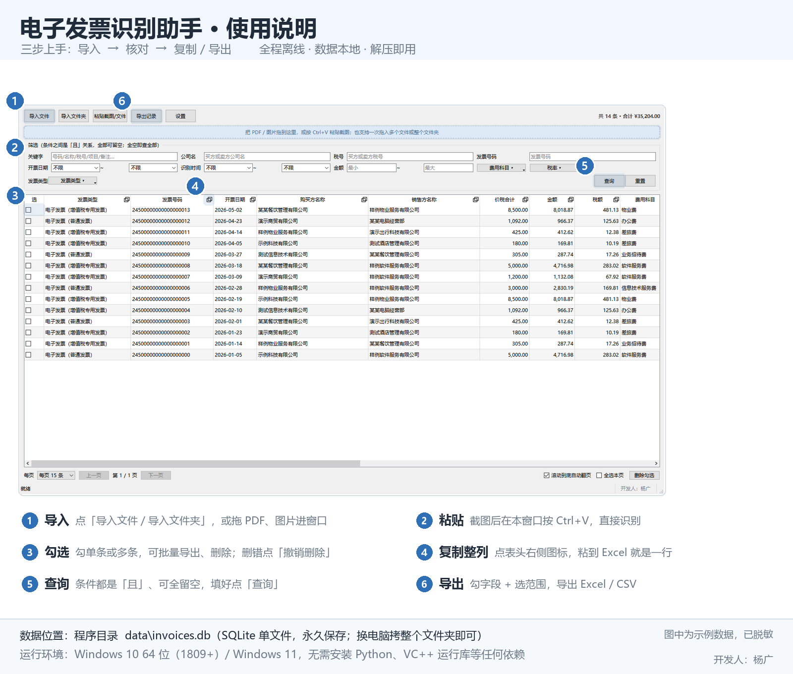

# 电子发票识别助手（Windows 离线版）

把 PDF 电子发票、发票图片或手机截图拖进窗口（或直接 `Ctrl+V` 粘贴），自动识别票面全部关键信息，
存入本地数据库长期保存，支持多条件查找、整列复制、勾选导出到 Excel。

**全程离线**：PDF 文本层本地解析 + 本地 OCR（PP-OCR ONNX，CPU 推理），不联网、不上传任何数据。
**免安装**：解压即用，不需要装 Python、VC++ 运行库或任何依赖。



## 功能

| 能力 | 说明 |
|---|---|
| 导入 | 拖入 / `Ctrl+V` 粘贴 / 选文件 / 选文件夹，单文件或批量 |
| 识别 | 数电票（普票/专票）与老版增值税电子发票；PDF 有文本层时精确解析，扫描件与截图走 OCR |
| 字段 | 类型、代码、号码、开票日期、购销双方名称与税号、项目名称、金额、税率、税额、价税合计（小写/大写）、备注、开票人、蓝红字、费用科目、识别时间、来源文件 |
| 存储 | SQLite 单文件，永久保存；同一张票（按号码）自动去重；最新识别永远排第一 |
| 复制 | 单元格文字可鼠标选中复制；表头右侧图标可复制整列（Tab 分隔，粘到 Excel 是一行） |
| 查询 | 关键字、公司名、税号、发票号码、开票日期、识别时间、金额区间、费用科目、税率、发票类型，条件为「且」关系且全部可留空 |
| 分页 | 每页 15 / 50 / 100 条，滚到底自动翻页 |
| 导出 | 勾选字段 + 勾选行，默认「当前查询的全部结果」（跨全部页面），导出 xlsx / csv |
| 删除 | 勾选单条或多条删除，可「撤销删除」恢复 |
| 费用科目 | 按关键词规则自动归类（餐饮→业务招待费、住宿→差旅费…），可手工修改，规则可维护 |

## 快速开始

### 方式一：直接下载（推荐）

到 [Releases](https://github.com/yangg27/invoice-ocr/releases) 下载 `电子发票识别助手.zip`，
解压后双击 `InvoiceOCR.exe`。解压后约 300 MB（Qt、OpenCV、ONNX Runtime 与 OCR 模型都在里面）。

### 方式二：从源码运行

```powershell
pip install -r requirements.txt
python run.py
```

需要 Python 3.13。

## 技术实现

识别链路的核心是「统一坐标版式」：

```
PDF ──(PyMuPDF 取字级 bbox)──┐
                             ├─→ token/行聚类 ─→ 模板判定 ─→ 表格推列 + 锚点取值 ─→ 字段
图片/截图 ──(RapidOCR ONNX)──┘                      │
                                                   └─→ 一致性校验（金额+税额=价税合计、大写↔小写）
```

- **为什么不按文本顺序正则**：数电票 PDF 的导出文本是「标签在前、数值全堆在后面」，且整行数字会粘成一个字符串，必须按坐标重建表格。
- **两类模板**：数电票（20 位号码、无代码/校验码）与老版增值税电子发票（代码 + 8 位号码 + 校验码 + 密码区），各自一套取值规则。
- **校验**：金额勾稽与大写一致性校验不通过时降低置信度并在告警里标出，便于人工复核。

### 目录结构

```
app/
  core/
    layout.py       token、行聚类、金额/日期/税率归一化
    textextract.py  PDF 文本层 / 图片 OCR → 统一版式
    ocr.py          RapidOCR 封装（离线）
    parser.py       两类票面解析 + 一致性校验
    engine.py       文件 → 记录（含费用科目归类）
    db.py           SQLite：存储、去重、多条件查询、分页
    exporter.py     xlsx / csv 导出
    fields.py       字段定义（表格列与导出列的唯一事实源）
  ui/               主窗口、表头复制按钮、多选下拉、导出/详情/设置弹窗
tools/              样本校验、界面自检、端到端自检、依赖闭合检查、干净环境测试、脱敏出图
packaging/          PyInstaller 配置
docs/               使用说明图、快速上手、准确率报告
```

## 准确率

在 55 份真实样本上，号码、日期、购销双方、双方税号、金额、税额、价税合计、大写、项目、税率的自动校验全部通过；
截图 OCR 通路（200dpi 渲染图与 1100px 压缩 JPEG）关键字段同样全对。详见 [docs/识别准确率报告.md](docs/识别准确率报告.md)。

已知限制：严重倾斜/反光/低分辨率的翻拍件 OCR 质量会下降；一页多票的版式暂不支持拆分。

## 打包

```powershell
$pkg = python -c "import rapidocr_onnxruntime,os;print(os.path.dirname(rapidocr_onnxruntime.__file__))"
python -m PyInstaller --noconfirm --clean --windowed --onedir --name InvoiceOCR `
  --icon assets\app.ico --add-data "assets\app.ico;assets" `
  --add-data "$pkg;rapidocr_onnxruntime" `
  --hidden-import ch_ppocr_v3_det --hidden-import ch_ppocr_v3_rec --hidden-import ch_ppocr_v2_cls `
  --paths "$pkg" `
  --exclude-module matplotlib --exclude-module pandas --exclude-module scipy `
  --exclude-module tkinter --exclude-module PyQt5 run.py
```

> 注意：RapidOCR 用 `importlib` 动态加载 `ch_ppocr_v3_det/rec`、`ch_ppocr_v2_cls` 三个子包，
> 必须把整个包目录作为 data 打进去，否则打包后一调用 OCR 就会报模块缺失。

## 运行环境

- Windows 10 64 位（1809+，推荐 21H2/22H2）或 Windows 11
- 无需安装 Python / VC++ 运行库 / .NET / Office（运行时与模型均已随包携带）
- 解压到可写目录；若放在只读位置，程序会把数据改存到 `%LOCALAPPDATA%\InvoiceOCR\data`

## 隐私

- 程序不发起任何网络请求，不含上传/遥测代码。
- 所有记录保存在程序目录的 `data/invoices.db`；记录删除为标记删除，原始数据仍在库中。
- 仓库中不包含任何真实发票、税号或业务数据；文档截图使用示例数据。

## License

[MIT](LICENSE) © 2026 杨广